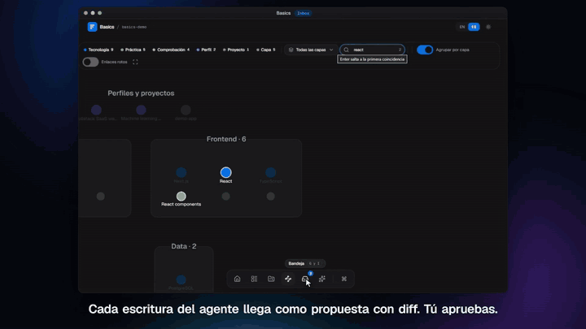

# Basics

[English](README.md) | Español

[](https://github.com/MarcozVD/basics/actions/workflows/ci.yml)
[](LICENSE)
[](https://www.npmjs.com/package/@marcozvd/basics)

Tu [agente](https://marcozvd.github.io/basics/guide/glossary.html#agent) de código (la herramienta de IA que escribe código por ti)
no sabe cómo construyes las cosas, así que adivina. Cada proyecto nuevo empieza de cero: el agente vuelve a elegir framework, base de
datos y herramienta de pruebas, y lo que decidiste en el proyecto anterior no pasa al siguiente.

Basics guarda esas decisiones en un [vault](https://marcozvd.github.io/basics/guide/glossary.html#vault): una carpeta de notas Markdown en texto plano que tus agentes leen por [MCP](https://marcozvd.github.io/basics/guide/glossary.html#mcp) antes de elegir un stack (las tecnologías que usa un proyecto) o escribir código. Lo que un agente quiera cambiar espera como una [propuesta](https://marcozvd.github.io/basics/guide/glossary.html#proposal) en tu inbox hasta que la apruebes.

El vault contiene:

- **Capas**: partes de tus aplicaciones, como backend, frontend y datos.
- **Tecnologías**: las que usas, como frameworks, bases de datos y herramientas de pruebas.
- **Prácticas**: reglas para usar bien una tecnología.
- **Checks**: comandos que verifican el trabajo, como pruebas y linters.
- **Perfiles**: stacks guardados para cada tipo de proyecto.

Empieza con packs oficiales (conjuntos de notas ya hechos) y pídele a Basics que recomiende tecnologías para un proyecto nuevo. Las notas son archivos normales, así que Obsidian y git también funcionan con ellas.

¿Palabras nuevas? Mira el [glosario](https://marcozvd.github.io/basics/guide/glossary.html). ¿Comparas opciones? Mira [cómo se compara Basics](https://marcozvd.github.io/basics/guide/comparison.html).

**Pruébalo:** [demo en vivo](https://marcozvd.github.io/basics/demo/) en tu navegador, sin instalar nada · [sitio web](https://marcozvd.github.io/basics/)

## Inicio rápido

Requiere Node.js 20.11 o posterior. Conecta Claude Code por stdio; no hace falta mantener un servidor ni la interfaz web en marcha:

```bash
# crea un vault con los packs oficiales
npx @marcozvd/basics init ~/basics-vault --yes

# conecta Claude Code (usa la ruta absoluta de tu vault)
claude mcp add basics -- npx -y --package @marcozvd/basics basics-mcp /ruta/absoluta/a/basics-vault
```

Pídele a tu agente que recomiende un stack. Para revisar y aprobar propuestas en el Inbox, abre la interfaz web cuando la necesites:

```bash
npx @marcozvd/basics --vault ~/basics-vault ui
```

Como alternativa, conecta por HTTP mientras la UI esté en marcha:

```bash
claude mcp add --transport http basics http://127.0.0.1:4747/mcp
```

El resto de clientes (Cursor, VS Code, Codex, OpenCode, Windsurf, oh-my-pi, Gemini CLI, Qwen Code, Kimi CLI, Goose, Amp) están en
[Clientes MCP](https://marcozvd.github.io/basics/guide/mcp-clients.html). Cualquier otro agente recibe fragmentos para copiar con `basics connect --print`.

## Qué hace

- **Un vault que puedes leer**: capas, tecnologías, prácticas, checks, perfiles y proyectos como notas Markdown. Sin base de datos ni formatos propietarios.
- **Agentes que preguntan antes**: lo que escribe un agente se convierte en una propuesta en `inbox/` con motivo y diff; la apruebas desde la CLI o la UI.
- **Stacks recomendados**: ordena tecnologías por capa a partir de la descripción de un proyecto, por keywords o con embeddings locales opcionales, con un pequeño ajuste según cómo terminaron tus proyectos anteriores.
- **Del stack al proyecto**: exporta `STACK.md`, `AGENTS.md`, `CLAUDE.md` y reglas de Cursor, y ejecuta los checks del stack en el proyecto.
- **Packs**: packs iniciales oficiales en inglés y español, además de packs comunitarios de cualquier repositorio de GitHub; las notas y actualizaciones nuevas llegan como propuestas al inbox, nunca como escrituras silenciosas.
- **UI web local y MCP**: interfaz React con editor, grafo, diff del inbox y banco de pruebas de recomendación, y MCP por HTTP o stdio.
- **Aplicación de escritorio**: la misma UI y servidor MCP en una ventana independiente residente en la bandeja, con su propio runtime de Node incluido; no hace falta npm. Ver [Aplicación de escritorio](https://marcozvd.github.io/basics/guide/desktop.html).
- **Skill para agentes**: un `SKILL.md` que enseña a Claude Code, OpenCode, Codex y a los demás agentes que configura `basics connect` cuándo usar cada herramienta de Basics. Ver [Skill para agentes](https://marcozvd.github.io/basics/guide/agent-skill.html).



Mira el recorrido completo de dos minutos (narración en español): [basics-demo.mp4](https://marcozvd.github.io/basics/media/basics-demo.mp4).

## Comparar con y sin Basics

`basics compare` ejecuta una misma tarea de código dos veces con tu agente: una vez sin Basics, y otra con Basics conectado mediante un servidor MCP de solo lectura y los archivos de instrucciones del stack. Cada ejecución empieza en su propia carpeta vacía. El informe muestra el stack que eligió el agente, los checks del proyecto que pasaron, el tiempo, los tokens reportados y los archivos escritos.

```bash
basics --vault ~/basics-vault compare --sample rust-api/login-api --agent claude --yes
```

- `--agent` (obligatorio): `claude`, `opencode` o `codex`.
- `--model`, `--runs` (repeticiones, por defecto 1) y `--timeout` (segundos por condición, por defecto 600).
- `--sample <pack>/<task-id>` para una tarea de ejemplo oficial, o una tarea entre comillas en su lugar.
- `--yes` aprueba las ejecuciones del agente. Nunca aprueba los comandos de checks.
- `--trust-checks` aprueba los comandos de checks del vault que se listan, solo para esta ejecución de compare. No se guarda nada como confianza.
- `--keep` conserva las carpetas de los proyectos y `--json` imprime el informe.

Cada ejecución del agente es una sesión completa que consume tu cuota o tus créditos. Compare muestra primero el número de sesiones previsto: por defecto son dos, y fuera de una terminal se necesita `--yes`. Antes de citar un resultado, lee la [guía de compare (en inglés)](https://marcozvd.github.io/basics/guide/compare.html). Una sola ejecución no demuestra nada, y la coincidencia de stack mide el acuerdo con la recomendación propia de Basics, no la calidad del código. La interfaz web tiene las mismas ejecuciones en una página Comparar (`g` y luego `c`), con progreso en vivo, cancelación e historial guardado.

## Documentación

Documentación completa: **[marcozvd.github.io/basics](https://marcozvd.github.io/basics/)**

- **Empezar**: [Primeros pasos](https://marcozvd.github.io/basics/guide/getting-started.html) · [Conceptos](https://marcozvd.github.io/basics/guide/concepts.html) · [Glosario](https://marcozvd.github.io/basics/guide/glossary.html) · [Comparativa](https://marcozvd.github.io/basics/guide/comparison.html)
- **Uso:** [Notas](https://marcozvd.github.io/basics/guide/notes.html) · [Packs](https://marcozvd.github.io/basics/guide/packs.html) · [Clientes MCP](https://marcozvd.github.io/basics/guide/mcp-clients.html) · [UI web](https://marcozvd.github.io/basics/guide/web-ui.html) · [Recomendación](https://marcozvd.github.io/basics/guide/recommend.html) · [Proyectos y checks](https://marcozvd.github.io/basics/guide/projects-and-checks.html) · [Compare](https://marcozvd.github.io/basics/guide/compare.html)
- **Operación**: [Seguridad](https://marcozvd.github.io/basics/guide/security.html) · [Problemas](https://marcozvd.github.io/basics/guide/troubleshooting.html) · [Estabilidad](https://marcozvd.github.io/basics/guide/stability.html)
- **Referencia**: [CLI](https://marcozvd.github.io/basics/reference/cli.html) · [Herramientas MCP](https://marcozvd.github.io/basics/reference/mcp-tools.html) · [Esquema del vault](https://marcozvd.github.io/basics/reference/schema.html)

Contribuciones: [CONTRIBUTING.md](CONTRIBUTING.md). Seguridad: [SECURITY.md](SECURITY.md).

## Licencia

MIT. Consulta [LICENSE](LICENSE).
