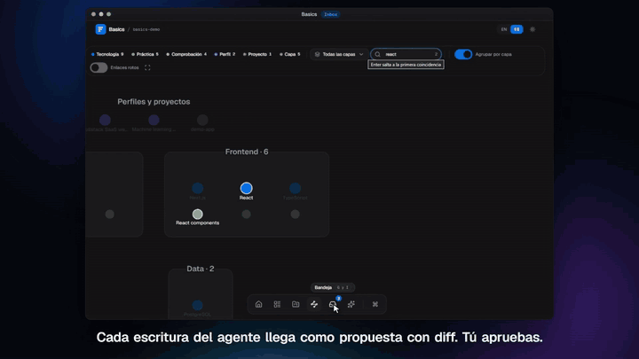

# Basics

English | [Español](README.es.md)

[](https://github.com/MarcozVD/basics/actions/workflows/ci.yml)
[](LICENSE)
[](https://www.npmjs.com/package/@marcozvd/basics)

Your coding [agent](https://marcozvd.github.io/basics/guide/glossary.html#agent) (the AI tool that writes code for you) does
not know how you build things, so it guesses. Every new project starts from zero: the agent picks a framework, a database and
a test tool again, and what you decided on the last project does not carry over.

Basics keeps those decisions in a [vault](https://marcozvd.github.io/basics/guide/glossary.html#vault): a folder of plain Markdown notes that your agents read over [MCP](https://marcozvd.github.io/basics/guide/glossary.html#mcp) before they choose a stack (the technologies a project uses) or write code. Anything an agent wants to change waits as a [proposal](https://marcozvd.github.io/basics/guide/glossary.html#proposal) in your inbox until you approve it.

The vault holds:

- **Layers**: parts of your applications, such as backend, frontend and data.
- **Techs**: the technologies you use, such as frameworks, databases and test tools.
- **Practices**: rules for using a tech well.
- **Checks**: commands that verify the work, such as tests and linters.
- **Profiles**: saved stacks for each kind of project.

Start from official packs (ready-made sets of notes) and ask Basics to recommend techs for a new project. Notes are plain files, so Obsidian and git work with them too.

New to these words? See the [glossary](https://marcozvd.github.io/basics/guide/glossary.html). Comparing options? See [how Basics compares](https://marcozvd.github.io/basics/guide/comparison.html).

**Try it:** [live demo](https://marcozvd.github.io/basics/demo/) in your browser, no install · [website](https://marcozvd.github.io/basics/)

## Quick start

Requires Node.js 20.11 or newer. Connect Claude Code over stdio; no running server or web UI needed:

```bash
# create a vault with the official packs
npx @marcozvd/basics init ~/basics-vault --yes

# connect Claude Code (use your vault's absolute path)
claude mcp add basics -- npx -y --package @marcozvd/basics basics-mcp /absolute/path/to/basics-vault
```

Ask your agent to recommend a stack. To review and approve proposals in the Inbox, open the web UI when needed:

```bash
npx @marcozvd/basics --vault ~/basics-vault ui
```

Alternatively, connect over HTTP while the UI is running:

```bash
claude mcp add --transport http basics http://127.0.0.1:4747/mcp
```

Other clients (Cursor, VS Code, Codex, OpenCode, Windsurf, oh-my-pi, Gemini CLI, Qwen Code, Kimi CLI, Goose, Amp) are covered in
[MCP clients](https://marcozvd.github.io/basics/guide/mcp-clients.html). Any other agent gets copyable snippets from `basics connect --print`.

## What it does

- **A vault you can read**: layers, tech, practices, checks, profiles and projects as Markdown notes. No database, no lock-in.
- **Agents that ask first**: agent writes become proposals in `inbox/` with a reason and a diff; you approve in the CLI or the UI.
- **Recommended stacks**: rank technologies per layer from a project description, by keywords or with optional local embeddings, with a small nudge from how your past projects went.
- **From stack to project**: export `STACK.md`, `AGENTS.md`, `CLAUDE.md` and Cursor rules, then run the stack checks in the project.
- **Packs**: official starter packs in English and Spanish, plus community packs from any GitHub repo; new notes and updates arrive as inbox proposals, never as silent writes.
- **Local web UI and MCP**: a React UI with editor, graph, inbox diff and recommendation playground, plus MCP over HTTP or stdio.
- **Desktop app**: the same UI and MCP server running in a standalone, tray-resident window with its own bundled Node runtime; no npm needed. See [Desktop app](https://marcozvd.github.io/basics/guide/desktop.html).
- **Agent skill**: a `SKILL.md` that teaches Claude Code, OpenCode, Codex and the other agents `basics connect` sets up when to call each Basics tool. See [Agent skill](https://marcozvd.github.io/basics/guide/agent-skill.html).



Watch the full two-minute tour (Spanish narration): [basics-demo.mp4](https://marcozvd.github.io/basics/media/basics-demo.mp4).

## Compare with and without Basics

`basics compare` runs one coding task twice with your agent: once plain, and once with Basics connected through a read-only MCP server and the stack's instruction files. Each run starts in its own empty folder. The report shows the stack the agent chose, the project checks that passed, wall time, reported tokens and the files written.

```bash
basics --vault ~/basics-vault compare --sample rust-api/login-api --agent claude --yes
```

- `--agent` (required): `claude`, `opencode` or `codex`.
- `--model`, `--runs` (repeats, default 1) and `--timeout` (seconds per condition, default 600).
- `--sample <pack>/<task-id>` for an official sample task, or a quoted task in its place.
- `--yes` approves the agent runs. It never approves check commands.
- `--trust-checks` approves the listed vault check commands for that invocation only. Nothing is saved to trust.
- `--keep` keeps the project folders and `--json` prints the report.

Each agent run is a full session that uses your quota or credits. Compare shows the planned count first: two sessions by default, and `--yes` is required outside a terminal. Before you quote a result, read the [compare guide](https://marcozvd.github.io/basics/guide/compare.html). One run proves nothing, and stack match measures agreement with Basics' own recommendation, not code quality. The web UI runs the same comparisons on a Compare page (`g` then `c`), with live progress, cancel and saved history.

## Documentation

Full documentation: **[marcozvd.github.io/basics](https://marcozvd.github.io/basics/)**

- **Start**: [Getting started](https://marcozvd.github.io/basics/guide/getting-started.html) · [Concepts](https://marcozvd.github.io/basics/guide/concepts.html) · [Glossary](https://marcozvd.github.io/basics/guide/glossary.html) · [Comparison](https://marcozvd.github.io/basics/guide/comparison.html)
- **Use:** [Notes](https://marcozvd.github.io/basics/guide/notes.html) · [Packs](https://marcozvd.github.io/basics/guide/packs.html) · [MCP clients](https://marcozvd.github.io/basics/guide/mcp-clients.html) · [Web UI](https://marcozvd.github.io/basics/guide/web-ui.html) · [Recommend](https://marcozvd.github.io/basics/guide/recommend.html) · [Projects and checks](https://marcozvd.github.io/basics/guide/projects-and-checks.html) · [Compare](https://marcozvd.github.io/basics/guide/compare.html)
- **Operate**: [Security](https://marcozvd.github.io/basics/guide/security.html) · [Troubleshooting](https://marcozvd.github.io/basics/guide/troubleshooting.html) · [Stability](https://marcozvd.github.io/basics/guide/stability.html)
- **Reference**: [CLI](https://marcozvd.github.io/basics/reference/cli.html) · [MCP tools](https://marcozvd.github.io/basics/reference/mcp-tools.html) · [Vault schema](https://marcozvd.github.io/basics/reference/schema.html)

Contributions: [CONTRIBUTING.md](CONTRIBUTING.md). Security reports: [SECURITY.md](SECURITY.md).

## License

MIT. See [LICENSE](LICENSE).
