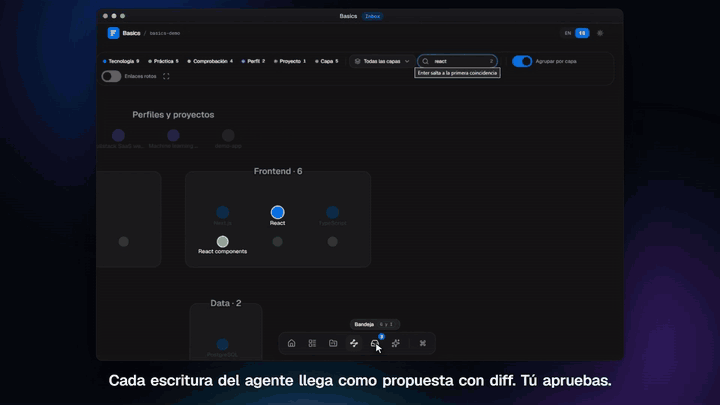

# Basics

English | [Español](README.es.md)

[](https://github.com/MarcozVD/basics/actions/workflows/ci.yml)
[](LICENSE)
[](https://www.npmjs.com/package/@marcozvd/basics)

Basics is a personal tech-stack vault: a folder of Markdown notes about the layers, technologies, practices, checks and
profiles you use, which your coding agents read and extend over MCP. Notes are plain files (frontmatter +
`[[wikilinks]]`, Obsidian- and git-friendly), and every agent write lands in an inbox for you to approve.

> **Status: 1.0** — see the [stability contract](https://marcozvd.github.io/basics/guide/stability.html).

## Quick start

```bash
# create a vault with the official packs
npx @marcozvd/basics init ~/basics-vault --yes

# open the local web UI (it also serves MCP over HTTP)
npx @marcozvd/basics --vault ~/basics-vault ui
```

With the UI running, connect Claude Code:

```bash
claude mcp add --transport http basics http://127.0.0.1:4747/mcp
```

Ask your agent to recommend a stack, then review and approve what it proposes in the Inbox.
Other clients (Cursor, VS Code, Codex, OpenCode, Windsurf) are covered in
[MCP clients](https://marcozvd.github.io/basics/guide/mcp-clients.html).

## What it does

- **A vault you can read** — layers, tech, practices, checks, profiles and projects as Markdown notes. No database, no lock-in.
- **Agents that ask first** — agent writes become proposals in `inbox/` with a reason and a diff; you approve in the CLI or the UI.
- **Recommended stacks** — rank technologies per layer from a project description, by keywords or with optional local embeddings.
- **From stack to project** — export `STACK.md`, `AGENTS.md`, `CLAUDE.md` and Cursor rules, then run the stack checks in the project.
- **Packs** — official starter packs in English and Spanish, plus community packs from any GitHub repo; new notes and updates arrive as inbox proposals, never as silent writes.
- **Local web UI and MCP** — a React UI with editor, graph, inbox diff and recommendation playground, plus MCP over HTTP or stdio.
- **Desktop app** — the same UI and MCP server running in a standalone, tray-resident window with its own bundled Node runtime; no npm needed. See [Desktop app](https://marcozvd.github.io/basics/guide/desktop.html).
- **Agent skill** — a `SKILL.md` that teaches Claude Code, OpenCode or Codex when to call each Basics tool. See [Agent skill](https://marcozvd.github.io/basics/guide/agent-skill.html).



Watch the full two-minute tour (Spanish narration): [basics-demo.mp4](https://marcozvd.github.io/basics/media/basics-demo.mp4).

## Documentation

Full documentation: **[marcozvd.github.io/basics](https://marcozvd.github.io/basics/)**

- **Start** — [Getting started](https://marcozvd.github.io/basics/guide/getting-started.html) · [Concepts](https://marcozvd.github.io/basics/guide/concepts.html)
- **Use** — [Notes](https://marcozvd.github.io/basics/guide/notes.html) · [Packs](https://marcozvd.github.io/basics/guide/packs.html) · [MCP clients](https://marcozvd.github.io/basics/guide/mcp-clients.html) · [Web UI](https://marcozvd.github.io/basics/guide/web-ui.html) · [Recommend](https://marcozvd.github.io/basics/guide/recommend.html) · [Projects and checks](https://marcozvd.github.io/basics/guide/projects-and-checks.html)
- **Operate** — [Security](https://marcozvd.github.io/basics/guide/security.html) · [Troubleshooting](https://marcozvd.github.io/basics/guide/troubleshooting.html) · [Stability](https://marcozvd.github.io/basics/guide/stability.html)
- **Reference** — [CLI](https://marcozvd.github.io/basics/reference/cli.html) · [MCP tools](https://marcozvd.github.io/basics/reference/mcp-tools.html) · [Vault schema](https://marcozvd.github.io/basics/reference/schema.html)

Contributions: [CONTRIBUTING.md](CONTRIBUTING.md). Security reports: [SECURITY.md](SECURITY.md).

## License

MIT — see [LICENSE](LICENSE).
